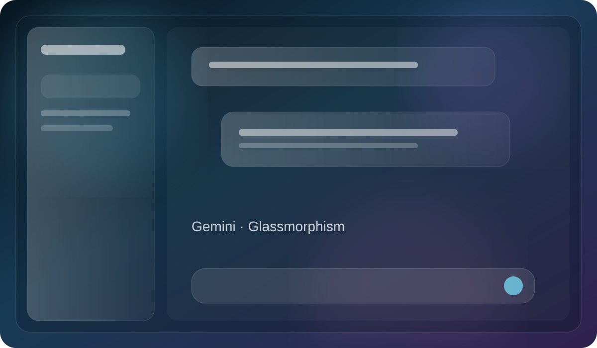
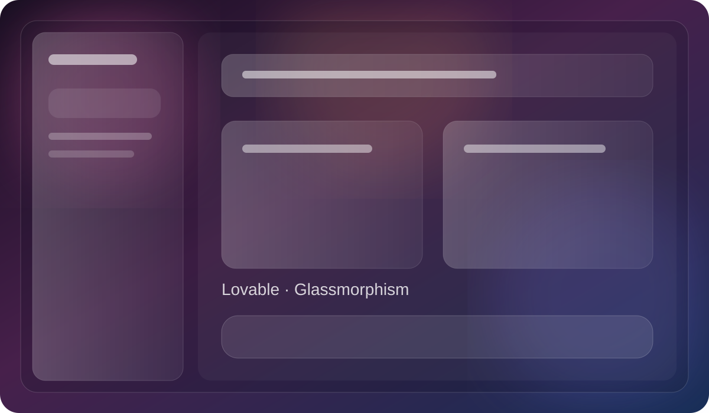

# ✦ Chrome UI Gallery

### Beautiful browser interfaces. Useful extensions. Built together.

**An open-source home for Chrome UI experiments and practical browser tools.**

[Explore UI Designs](./ui/README.md) · [Explore Tools](./Tools/README.md) · [Live gallery features](https://ruslansharifov.github.io/chrome-ui-gallery/#compare) · [DevLens](./Tools/devlens/README.md) · [Get Started](./GETTING_STARTED.md) · [Contribute](./CONTRIBUTING.md)

[Azərbaycan dili](./GETTING_STARTED.az.md) · [English](./GETTING_STARTED.md)

---

## ✨ What would you like to do?

| 🎨 Explore visual designs | 🧰 Find useful tools |
| :--- | :--- |
| Custom themes and interactive UI experiments for ChatGPT, Gemini, GitHub and Lovable. | Standalone Chrome extensions to solve everyday browser problems. |
| **[Browse all UI designs →](./ui/README.md)** | **[Browse all tools →](./Tools/README.md)** |

| 🚀 Install your first extension | 🤝 Publish your extension |
| :--- | :--- |
| No coding experience required. Follow a step-by-step installation guide. | Add a tool or design with your name credited and a reviewable pull request. |
| **[Beginner-friendly guide →](./GETTING_STARTED.md)** | **[Contribution guide →](./CONTRIBUTING.md)** |

## 🔄 The gallery updates itself

**Contributors add their extension folder; the website adds the card automatically after approval.**
A GitHub Action scans each **manifest.json**, reads optional **gallery.json** for attribution and visual style, then rebuilds the searchable site on every merge to main. Nobody needs to edit the website's HTML, JavaScript project list or totals.

[Read the automatic publishing guide](./docs/README.md) · [Customize your tool card](./docs/CATALOG.md)

## 🔎 Find the gallery through search

The [live website](https://ruslansharifov.github.io/chrome-ui-gallery/) includes a [Google Search sitemap](https://ruslansharifov.github.io/chrome-ui-gallery/sitemap.xml). See the [Search Console setup guide](./docs/SEO.md) for submission and indexing steps. Search engines decide whether and when to index pages.

## 🎨 Featured UI collections

| ChatGPT | Gemini |
| :---: | :---: |
|  |  |
| [Open ChatGPT designs](./chatgpt/README.md) | [Open Gemini designs](./gemini/README.md) |

| GitHub | Lovable |
| :---: | :---: |
| [**GitHub themes →**](./github/README.md) |  |
| Glassmorphism · Liquid Glass · 3D | [Open Lovable designs](./lovable/README.md) |

## 🧰 Featured tools

| Tool | What it does | Install |
| :--- | :--- | :--- |
| [ChatGPT Lag Fixer](./Tools/chatgpt-lag-fixer/README.md) | Improves responsiveness in long conversations | [Instructions](./Tools/chatgpt-lag-fixer/INSTALL.md) |
| [Cookie Manager Pro](./Tools/cookie-manager-pro/README.md) | Inspect and manage browser cookies | [Instructions](./Tools/cookie-manager-pro/README.md#installation) |
| **[DevLens](./Tools/devlens/README.md)** | Floating developer HUD for console errors, logs and page fetch/XHR diagnostics | [Install & use](./Tools/devlens/README.md#-installation) · [Preview](./Tools/devlens/preview.png) |
| **[TabPocket](./Tools/tabpocket/README.md)** | Save, organize, search and restore tab collections locally | [Install & use](./Tools/tabpocket/README.md#install) · [Source](./Tools/tabpocket/) |

## 🪄 Try an extension in four steps

1. Choose a [UI design](./ui/README.md) or [tool](./Tools/README.md).
2. Download the source using **Code → Download ZIP**, then extract the ZIP.
3. Open **chrome://extensions** and enable **Developer mode**.
4. Click **Load unpacked** and select the exact project folder containing **manifest.json**.

> Chrome shows the permissions an extension requests. Review them before installing. These are community-maintained experiments, not official products of the platforms they customize.

**[Detailed guide with Windows instructions →](./GETTING_STARTED.md)** · [Azərbaycan dilində →](./GETTING_STARTED.az.md)

## 🤝 Build this gallery with us

Developers of every experience level are welcome. You can submit a new browser tool, design a UI theme, fix a bug, improve translations, or update documentation.

**[How to contribute →](./CONTRIBUTING.md)** · [Submit a tool →](./CONTRIBUTING.md#add-a-new-tool) · [Start from the extension template →](./templates/chrome-extension-tool/README.md) · [Report a bug →](https://github.com/RuslanSharifov/chrome-ui-gallery/issues/new/choose)

## 📁 Where things live

| Area | Location | Purpose |
| :--- | :--- | :--- |
| UI directory | [ui/](./ui/README.md) | Single catalog for visual styles and platform designs |
| Platform source | [chatgpt/](./chatgpt/README.md) · [gemini/](./gemini/README.md) · [github/](./github/README.md) · [lovable/](./lovable/README.md) | Existing, stable extension source paths |
| Tool source | [Tools/](./Tools/README.md) | Independent extension folders |
| Templates | [templates/](./templates/README.md) | Starter files for contributors |
| Guides | [setup/](./setup/README.md) | Multilingual installation and development guides |
| Showcase website | [docs/](./docs/README.md) | Responsive searchable catalog; GitHub Pages-ready |

Keeping the existing platform folders in place preserves older GitHub links. The [architecture guide](./ARCHITECTURE.md) explains how the **UI** and **Tools** collections stay logically separate without breaking old URLs.

## 📜 License and safety

The gallery's original contributions are distributed under the [MIT License](./LICENSE), subject to the [license inventory and third-party exceptions](./LICENSES.md). Each external component may have its own license. Review [Security](./SECURITY.md) and [Community Standards](./CODE_OF_CONDUCT.md) before publishing.

---

**Made for people who enjoy building a better browser.**

[UI Gallery](./ui/README.md) · [Tools](./Tools/README.md) · [DevLens](./Tools/devlens/README.md) · [Contributing](./CONTRIBUTING.md) · [GitHub Issues](https://github.com/RuslanSharifov/chrome-ui-gallery/issues)

