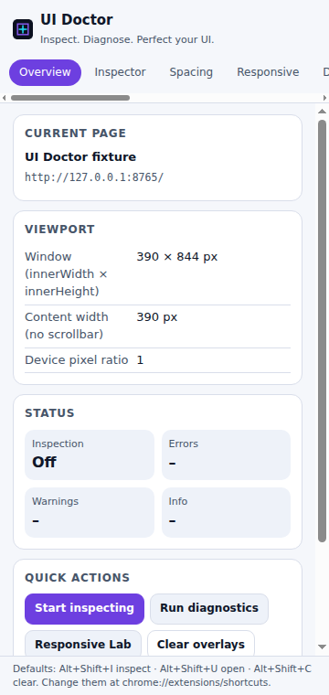
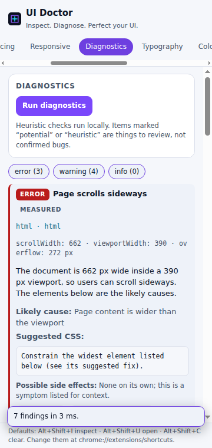

# UI Doctor — Visual Debugger & Responsive Tester

> Inspect. Diagnose. Perfect your UI.

UI Doctor is a Chrome extension (Manifest V3) for frontend developers, UI developers, web designers and QA engineers. It inspects a page visually, measures spacing, runs layout diagnostics at common breakpoints, shows typography and colour contrast, and lets you try CSS changes temporarily, all without writing JavaScript in DevTools.

Developed by **Ruslan Sharifov** · [GitHub](https://github.com/RuslanSharifov) · [Repository](https://github.com/RuslanSharifov/chrome-ui-gallery) · [Chrome UI Gallery](https://ruslansharifov.github.io/chrome-ui-gallery/)




## Features

- **Element Inspector**: hover outlines and tooltip, click to select, computed styles, CSS selector, copy selector and copy computed styles. Overlays never change page layout, and Esc stops inspection.
- **Spacing Inspector**: margin, padding and content overlays. Shift+click a second element to measure the bounding-box gap; CSS margins are shown separately and labelled as declared values.
- **Responsive Lab**: presets for mobile, tablet and desktop, custom sizes, portrait and landscape, favourites, and a breakpoint sweep that runs overflow diagnostics at each size. Tests run in a dedicated window, and your main window is never resized.
- **Diagnostics**: horizontal overflow, elements outside the viewport, clipped text, oversized images and fixed-width containers, small interactive targets, possible overlaps and alignment inconsistencies. Each finding has a severity, certainty, measurement, explanation, likely cause, suggested CSS and possible side effects. Click *Highlight element* to find it on the page.
- **Typography**: font, size, weight, line height, spacing, alignment, transform, decoration, white-space and word-break, with a comparison against a pinned element and a clipping check.
- **Colours & contrast**: text and background HEX and RGB, WCAG 2.x contrast ratio, AA and AAA results, and alpha blending. Where the background can't be determined reliably (gradients, background images), it reports *Unable to determine accurately*.
- **CSS Playground**: edit supported properties on the selected element, undo individual changes, reset all, copy the resulting CSS. Changes are temporary and never edit site files.
- **Reports**: export JSON or a standalone HTML report, or copy a summary. All page text is escaped.
- **Settings**: light, dark or system theme; reduced motion; default preset; overlay colours; px or rem units; severity filters.

Everything runs locally. There is no telemetry, no analytics and no remote AI service.

## Installation

1. Download `UI-Doctor-v1.0-Chrome-Extension.zip` and extract it, or use the `Tools/UI-Doctor-v1.0-Chrome-Extension/` folder of this repository.
2. Open `chrome://extensions`.
3. Turn on **Developer mode**.
4. Click **Load unpacked** and select the extracted `UI-Doctor-v1.0-Chrome-Extension` folder (the one that contains `manifest.json`).
5. Pin the UI Doctor icon from the Extensions menu.

Requires Chrome 116 or later.

## Usage

1. Open a regular `http://` or `https://` page.
2. Click the UI Doctor icon. The popup offers quick actions, and **Open UI Doctor** opens the side panel.
3. Use the side panel sections: Overview, Inspector, Spacing, Responsive, Diagnostics, Typography, Colors, CSS Playground, Reports, Settings and About.

Default keyboard shortcuts (change them at `chrome://extensions/shortcuts`):

| Action | Shortcut |
| --- | --- |
| Toggle inspection | Alt+Shift+I |
| Open the side panel | Alt+Shift+U |
| Clear overlays | Alt+Shift+C |
| Stop inspection | Esc (while inspecting) |

## Required permissions

| Permission | Why it is needed |
| --- | --- |
| `activeTab` | Runs UI Doctor on the page you are looking at, only after you click the icon or a shortcut. |
| `scripting` | Injects the page engine (`content/ui-doctor.js`) into that page. |
| `sidePanel` | Shows the main interface. |
| `storage` | Saves your settings, favourite sizes and recent results on this device. |
| Optional host access (`http://*/*`, `https://*/*`) | Requested per site only when you use a feature that needs it later: *Allow access to this site*, or opening the Responsive Lab test window. Nothing is requested at install time. |

## Privacy

- All analysis runs locally in your browser.
- No telemetry, analytics, remote scripts, remote AI services or paid APIs.
- No credential collection and no browsing-history collection.
- Settings and recent results are kept in `chrome.storage` on this device.
- Reports can contain page URLs, titles, selectors and text from the site you inspected. Review them before sharing.

## Known limitations

- **Responsive Lab sizing depends on the browser and OS.** UI Doctor measures the real content viewport (`window.innerWidth`) after resizing and corrects for window chrome. If the browser or OS won't honour a size (for example, minimum window widths), the result is labelled as not matching, not forced. Device emulation (touch, device pixel ratio, user agent) is not provided.
- **Diagnostics are heuristic.** Findings marked *potential* or *heuristic* need human review. Intentional overlaps, off-screen drawers and transforms are filtered where possible, not perfectly.
- **Contrast is a single-element check**, not an accessibility audit. Gradients, background images and reduced opacity are reported as *Unable to determine accurately*.
- **Playground changes are inline styles.** A stylesheet rule with higher specificity still wins unless you use `!important`. Changes are lost on reload.
- **Restricted pages** (`chrome://`, the Chrome Web Store, PDF viewer, other extension pages) can't be inspected.
- **After you navigate**, Chrome may revoke `activeTab`. Click the UI Doctor icon again, or use *Allow access to this site*.
- **Icons** are generated by `icons/make_icons.py` (standard library only). The UI uses text labels rather than an icon font.

## File structure

```
UI-Doctor-v1.0-Chrome-Extension/
├── manifest.json                 Manifest V3 definition, permissions, commands
├── README.md                     This file
├── design.md                     Design system, architecture and file responsibilities
├── popup/                        Toolbar popup: quick actions, settings/GitHub/About links
│   ├── index.html
│   ├── popup.css
│   └── popup.js
├── sidepanel/                    Main application (Chrome Side Panel API)
│   ├── index.html
│   ├── panel.css
│   └── panel.js
├── content/
│   └── ui-doctor.js              Page engine: inspector, overlays, spacing, diagnostics, contrast, playground
├── background/
│   └── service-worker.js         Injection, commands, Responsive Lab test window, message relay
├── shared/
│   ├── presets.js                Viewport presets
│   └── utils.js                  Settings defaults, escaping, storage helpers
├── icons/
│   ├── icon16.png · icon32.png · icon48.png · icon128.png
│   └── make_icons.py             Reproducible icon generator
└── docs/screenshots/             Screenshots used in this README
```

## Author

Ruslan Sharifov — [github.com/RuslanSharifov](https://github.com/RuslanSharifov)
