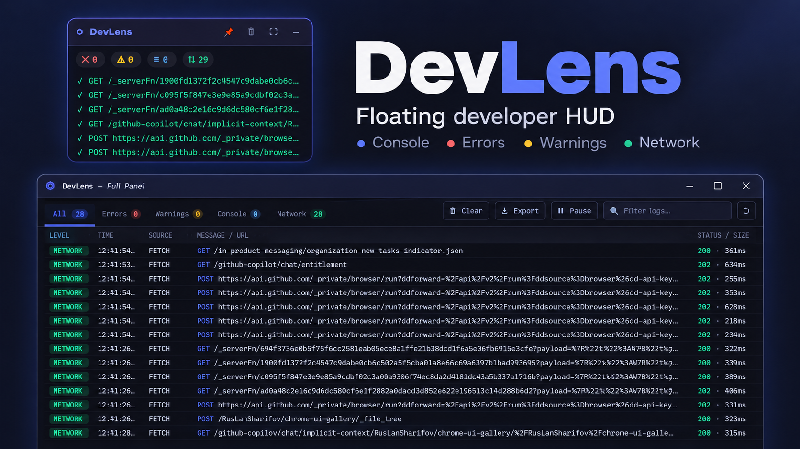

# ⬡ DevLens

[← All tools](../README.md) · [Gallery home](../../README.md) · [Install guide](../../GETTING_STARTED.md) · [Contribution guide](../../CONTRIBUTING.md)

> **Floating developer overlay for Chrome** — live console logs, JS errors and network requests on top of any page. No DevTools panel required.

[](./preview.png)

[View full-size preview](./preview.png) · [Download source](./) · [Chrome installation instructions](#-installation)

---

## ✨ Features

### 🪟 Floating Mini HUD
- Appears on every page as a small, draggable overlay panel
- Works **without opening F12 / DevTools**
- Drag to any screen position; four preset anchor corners
- Minimize to a compact pill badge; restore with one click
- Configurable opacity (40–100%) and dark/light theme

### 🔴 Live Error & Counter Badges
- Real-time badge counters for **Errors**, **Warnings**, **Logs** and **Network**
- Error badge pulses red when JS errors are detected
- Mini log stream shows the last 6 entries inline

### 📋 Console Capture
- Intercepts `console.log`, `info`, `warn`, `error`, `debug`, `table`, `group`, `trace` and more
- Catches **uncaught JavaScript errors** (`window.onerror`)
- Catches **unhandled Promise rejections** (`unhandledrejection`)
- Full stack trace stored for every error

### 🌐 Network Monitor
- Patches **`fetch`** and **`XMLHttpRequest`** in the page world at document start (only requests made after injection and via those APIs are visible)
- Captures: method, URL, HTTP status, duration (ms), and reported response size when available; does not read response bodies
- Shows in-progress and completed requests separately

### ⛶ Full DevTools Panel
- Click the **⛶** button on the HUD (or the popup) to open a standalone panel window
- **Tab bar:** All · Errors · Warnings · Console · Network
- **Live table:** level badge, timestamp, source, message/URL, status/size
- **Detail drawer:** click any row to see full message, stack trace or request details
- **Search / filter** across all entries in real time
- **Pause / Resume** live panel updates (the HUD still captures while the panel is paused)
- **⬇ Export** all logs as a timestamped JSON file
- Keyboard shortcuts: `Ctrl+K` clear · `Ctrl+F` focus search · `Esc` close drawer

### ⚙️ Popup Settings
- Toggle HUD visibility per tab
- Choose HUD corner position (4 presets)
- Dark / Light theme switch (synced to panel)
- Opacity slider
- Per-category show/hide toggles (Errors · Warnings · Logs · Network)
- One-click **Clear Logs** button

---

## 📦 Installation

### Load unpacked (development)

1. Download or clone the [Chrome UI Gallery repository](https://github.com/RuslanSharifov/chrome-ui-gallery) (see the [beginner installation guide](../../GETTING_STARTED.md)).
2. Copy the `devlens/` folder into `chrome-ui-gallery/Tools/` (or wherever you want it).
3. Open Chrome and navigate to `chrome://extensions/`.
4. Enable **Developer mode** (toggle in the top-right corner).
5. Click **Load unpacked**.
6. Select the `Tools/devlens/` folder.
7. The DevLens icon appears in your toolbar. Navigate to any page and the HUD will appear.

### From the Chrome Web Store
Not yet published — contributions welcome!

---

## 🖥️ Usage

| Action | Result |
|---|---|
| Browse to any page | HUD appears automatically |
| Drag the HUD header | Repositions the overlay |
| Click **−** | Minimizes to a pill |
| Click the pill | Restores the HUD |
| Click **⛶** | Opens the full panel window |
| Click **🗑** | Clears all captured logs |
| Click **📌** | Pins the HUD (keeps it on top) |
| Open popup | Configure position, theme, opacity |

### Full Panel Keyboard Shortcuts
| Key | Action |
|---|---|
| `Ctrl + K` | Clear all logs |
| `Ctrl + F` | Focus search box |
| `Esc` | Close detail drawer / blur search |
| Click a row | Open detail drawer |

---

## 🔗 Quick links

[Preview image](./preview.png) · [Manifest](./manifest.json) · [Gallery metadata](./gallery.json) · [Source folder](./) · [Chrome popup](./popup/popup.html) · [HUD script](./content/hud.js) · [Diagnostics panel](./panel/panel.html) · [Background service worker](./background/service-worker.js) · [MIT license](./LICENSE)

## 🗂️ File Structure

```
Tools/devlens/
├── manifest.json              # Chrome Manifest V3
├── gallery.json               # chrome-ui-gallery catalog metadata
├── preview.png                # GitHub README and live gallery preview image
├── README.md                  # This file
├── LICENSE                    # MIT License
│
├── icons/
│   ├── icon16.png
│   ├── icon32.png
│   ├── icon48.png
│   └── icon128.png
│
├── content/
│   ├── page-hook.js           # MAIN-world page console + fetch + XHR hook
│   ├── interceptor.js         # Isolated bridge to extension and HUD
│   ├── hud.js                 # Floating HUD overlay controller
│   └── hud.css                # HUD styles (injected via content_scripts)
│
├── panel/
│   ├── panel.html             # Full DevTools-style panel page
│   ├── panel.css              # Panel styles (dark + light theme)
│   └── panel.js               # Panel logic: rendering, filtering, export
│
├── popup/
│   ├── popup.html             # Extension popup
│   ├── popup.css              # Popup styles
│   └── popup.js               # Popup settings controller
│
└── background/
    └── service-worker.js      # MV3 service worker: routes events, manages panel window
```

---

## 🔒 Permissions

| Permission | Reason |
|---|---|
| `storage` | Persists HUD settings across sessions |
| `content_scripts.matches: <all_urls>` | Broad page access required to display the overlay and observe console and page fetch/XHR activity; review this access before installing. |

**Privacy:** DevLens captures diagnostic messages and URLs from web pages and stores recent entries in extension memory. No external servers are contacted by DevLens. Full logs may contain sensitive values such as tokens in URLs or console output. Only export/share reports after removing secrets. Buffers may be lost when the service worker suspends, and only the current page is sampled. Chrome internal pages are not supported.

---

## 🏗️ Architecture

```
Page context (MAIN world)        Content script context
┌─────────────────────────┐         ┌──────────────────────────┐
│  Patched console.*      │──────▶  │  interceptor.js          │
│  Patched fetch / XHR    │  events │  (listens via CustomEvent)│
└─────────────────────────┘         │  pushes to __devlens_events__│
                                    │  dispatches devlens:entry │
                                    └────────────┬─────────────┘
                                                 │
                                    ┌────────────▼─────────────┐
                                    │  hud.js                  │
                                    │  (floating overlay DOM)  │
                                    └────────────┬─────────────┘
                                                 │ chrome.runtime.sendMessage
                                    ┌────────────▼─────────────┐
                                    │  service-worker.js       │
                                    │  (buffers events,        │
                                    │   opens panel window)    │
                                    └────────────┬─────────────┘
                                                 │
                                    ┌────────────▼─────────────┐
                                    │  panel/panel.html        │
                                    │  (full DevTools viewer)  │
                                    └──────────────────────────┘
```

---

## 🤝 Contributing

Contributions, bug reports and feature requests are welcome!

1. Fork [chrome-ui-gallery](https://github.com/RuslanSharifov/chrome-ui-gallery)
2. Create a branch: `git checkout -b fix/devlens-my-fix`
3. Make changes inside `Tools/devlens/` only
4. Do not modify `docs/`, `docs/app.js`, `docs/catalog.json` or `docs/index.html`
5. Open a Pull Request

---

## 👤 Author

**Ruaaln** (as supplied in the original ZIP; verify attribution before contributing)
GitHub: [https://github.com/RuslanSharifov](https://github.com/RuslanSharifov)
Repository: [chrome-ui-gallery](https://github.com/RuslanSharifov/chrome-ui-gallery)

---

## 📄 License

[MIT](LICENSE) © 2024 Ruaaln

---

## 🧩 Compatibility

| Browser | Support |
|---|---|
| Chrome 111+ | ✅ Full support (Manifest V3) |
| Chromium-based (Edge, Brave, Arc) | ✅ Should work |
| Firefox | ❌ Not supported (MV3 differences) |
| Safari | ❌ Not supported |

## Verification notes

- Runs on regular website pages; Chrome restricted pages (including `chrome://` and the Web Store) do not permit content script injection.
- Capturing occurs for console, fetch and XHR after injection; it does not provide complete browser-level DevTools network logging.
- The extension requests broad site access through declarative content script matches. Review this before installing or publishing.
- The author and copyright lines originated in the submitted ZIP and must be verified against the actual rights holder before a public Pull Request.

---

[← Browse all tools](../README.md) · [← Chrome UI Gallery home](../../README.md) · [Report an issue](https://github.com/RuslanSharifov/chrome-ui-gallery/issues/new/choose) · [See other extension examples](../../templates/README.md)
