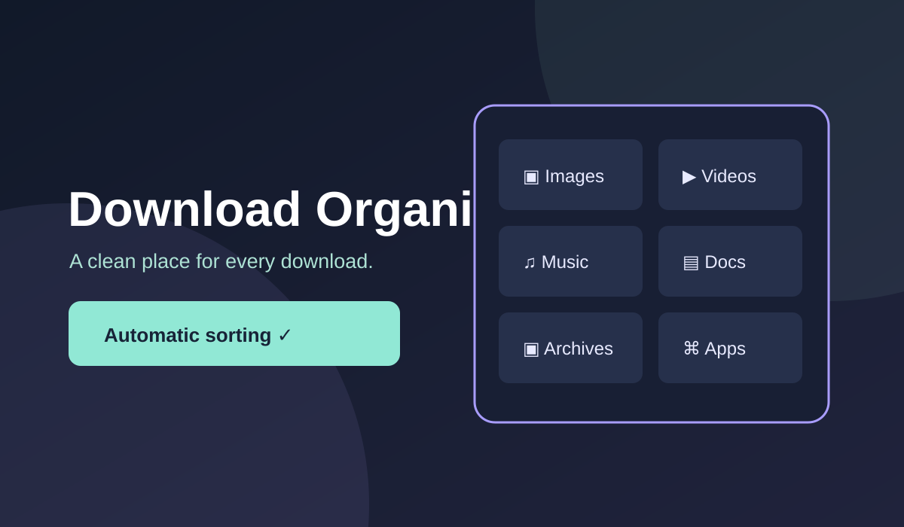

# Download Organizer

[← Tools](../README.md) · [Live Gallery](https://ruslansharifov.github.io/chrome-ui-gallery/gallery.html)

Automatically place **new** Chrome downloads into folders under `Downloads/Organized Downloads/` by file extension. Switch it off any time. No account, no external service and no tracking.

## Install (Chrome)

1. Download or clone this repository.
2. Open `chrome://extensions` in Google Chrome.
3. Turn on **Developer mode**, click **Load unpacked**.
4. Select the `Tools/download-organizer` folder containing `manifest.json`.
5. Click **Download Organizer** in the Chrome extensions toolbar. Sorting is enabled by default; use the switch to pause.

## What gets organized

- `Downloads/Organized Downloads/Images/` — PNG, JPG, GIF, SVG, etc.
- `Videos/` — MP4, MOV, WebM and more.
- `Music/` — MP3, WAV, FLAC and more.
- `Documents/` — PDF, DOCX, TXT, XLSX, EPUB and more.
- `Archives/` — ZIP, RAR, 7z and more.
- `Applications/` — EXE, MSI, APK and more.
- `Others/` — unknown file extensions.

Example: downloading `photo.png` normally saves it as `Downloads/Organized Downloads/Images/photo.png`.

## Safety and limitations

**Only new downloads** are organized at save time. Existing files never move or get deleted. Duplicate filenames are automatically renamed instead of overwritten. Sorting is off when the switch is off. All classification is done locally. Browser download prompts and third-party extensions can override or compete with filename suggestions. Nested paths suggested by another extension are intentionally left untouched when recognizable. Chrome downloads permission is required to suggest folders and show recent downloads. File paths are displayed locally in the popup and are never uploaded. The optional Ko-fi link is fetched from the project's central public configuration and hidden offline.

The extension cannot rename or relocate existing files elsewhere on your computer and cannot access arbitrary folders. The **Open Downloads** button opens Chrome's download manager; **Show** opens the containing folder for a recent file.

## Files

- [manifest.json](./manifest.json) — Manifest V3 and permissions
- [background.js](./background.js) — filename determination and classification
- [popup.html](./popup.html), [popup.css](./popup.css), [popup.js](./popup.js) — controls and recent downloads
- [icon.svg](./icon.svg), [preview.svg](./preview.svg) — branding and cover
- [gallery.json](./gallery.json) — Gallery metadata
