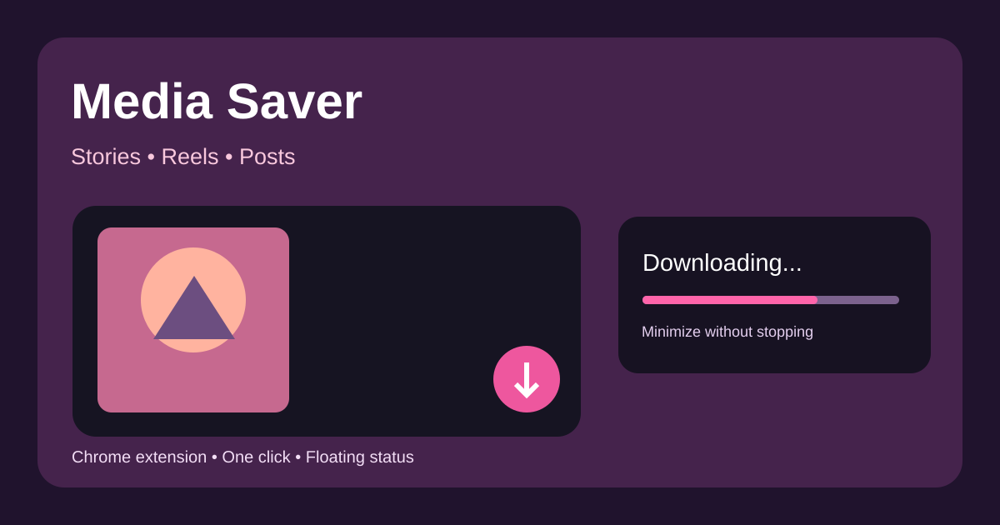

# Instagram Media Saver v2 — Media Island

[← All Tools](../README.md) · [Design notes](./design.md) · [Gallery poster](./poster.svg)

A draggable and always-visible Instagram download island with **three UI states**:

- **Small:** persistent floating capsule when idle.
- **Medium:** animated horizontal transfer indicator while downloads run.
- **Large:** download library, embedded video preview, media controls and appearance settings.

The library lists completed and in-progress downloads. Video preview uses the original media URL and may stop working after the URL expires; the downloaded file remains in Chrome Downloads. The player offers previous, next, play/pause and volume. **Remove from library** deletes the record only, never the file on disk. The island's position and theme preferences persist in Chrome local extension storage.

## Media controls

The extension adds contextual **↓** buttons beside Instagram content action menus and on visible video containers, including Reels and video messages when Instagram exposes the media in the page DOM. Right-clicking visible media also opens a compact **Download** context menu. This uses right-click intentionally to avoid interfering with the native left-click video playback. Story actions are attached to available menu controls. Since Instagram frequently changes its DOM, placement may require maintenance.

Paste an Instagram post/Reel/Story URL into the large island to **open that page**; click its visible-media download control there. Direct accessible Instagram-hosted media URLs can download immediately. Arbitrary page links cannot be reliably converted to files without server APIs.

## Save location

The default folder is `Downloads/Instagram_Media_Saver/`. Customize the folder name/subpath in island Settings; Chrome creates relative download subfolders as needed. Chrome Manifest V3 does **not** allow choosing any arbitrary folder in the OS with a native filesystem folder picker for `chrome.downloads.download`. Use **Open downloads folder** to open the system-managed download location.

## Settings

Ready palettes (Aurora, Ocean, Mint, Pearl), custom accent/surface/text colors, appearance preference, opacity, glass blur, slime transition toggle, draggable placement with reset, context-menu toggle and download subfolder.

## Install

1. Clone or download the repository.
2. Go to `chrome://extensions` and turn on Developer mode.
3. **Load unpacked** → choose `Tools/instagram-media-saver`.
4. Refresh Instagram and test a visible post/Reel/Story.
5. Open island → Settings to customize.

## Source

[Manifest](./manifest.json) · [Content script](./content.js) · [Background worker](./background.js) · [Styles](./style.css) · [Logo](./icons/icon.svg) · [Poster](./poster.svg) · [Gallery metadata](./gallery.json) · [Design documentation](./design.md)

## Privacy and constraints

No cookie extraction, login token access, scraping of private GraphQL endpoints or privacy bypass. Only media with accessible URLs can be downloaded. Browser-native download errors and expired media links remain possible. No playback guarantee for browser-stored history after media URLs expire. Please respect copyright and privacy rights. Not affiliated with Instagram/Meta.
