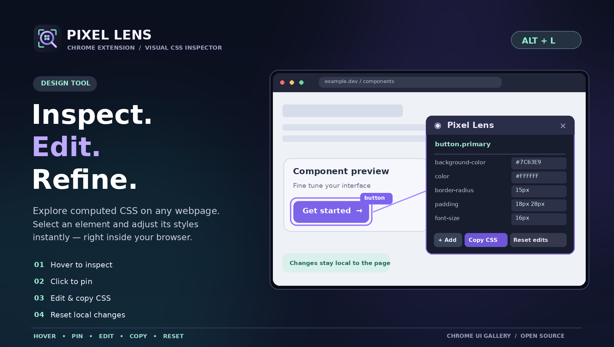

# Pixel Lens

[View full-size cover](./pixel-lens-poster.png)

### Pixel Lens logo

**Pixel Lens** uses its own magnifier-and-pixels logo from the supplied Pixel Lens assets, not the Chrome UI Gallery cube.

[Full-size logo SVG](./pixel-lens-logo.svg) · [128px PNG](./icons/icon128.png) · [48px PNG](./icons/icon48.png) · [32px PNG](./icons/icon32.png) · [16px PNG](./icons/icon16.png)

A lightweight **visual CSS inspector** for Chrome. Hover a page element to read its computed styles beside the pointer, click to pin the element, and edit its CSS **locally** without changing the underlying source files.

[← Developer Tools](../README.md) · [← Chrome UI Gallery](../../README.md) · [Live Gallery](https://ruslansharifov.github.io/chrome-ui-gallery/gallery.html)

## Installation

1. Clone or download the repository.
2. Open `chrome://extensions` and enable **Developer mode**.
3. Choose **Load unpacked** and select `Tools/pixel-lens` (the folder with `manifest.json`).
4. Visit a regular HTTP/HTTPS website, open Pixel Lens and click **Activate Pixel Lens**.

## Features

- Floating inspector follows the pointer but stays inside the browser viewport.
- Displays applicable computed CSS: text and background colors, typography, dimensions, margin/padding, border, radius, shadow, opacity, layout and more.
- Omits many empty/default/no-op properties rather than showing a long unfiltered dump.
- **Click** an element to pin it and highlight its bounding rectangle. The floating panel follows the element on scroll and hides briefly while scrolling. Click outside the selected element to close the panel.
- Drag the inspector by its header to reposition it. Its internal scrollbar is hidden, while mouse wheel/touch scrolling still works.
- **+ Add** applies another CSS property and value to the pinned element.
- Edit shown property values in the inspector; **Copy CSS** copies the visible computed properties.
- **Reset edits** restores originally edited inline values. All changes are local to the current page; reload also resets them.
- **Esc** unpins the selection (or stops the inspector when nothing is pinned).
- **Persistent keyboard shortcut:** defaults to Alt + L. Change it in the extension popup by clicking **Change**, holding Ctrl or Alt and pressing a letter. The choice is stored in `chrome.storage.local` and works on supported websites without opening the popup. Chrome or a website can reserve some combinations; choose a different shortcut if needed.

## Privacy and permissions

The inspector runs locally in the currently selected web tab using Chrome's `activeTab` and `scripting` permissions. It does **not** upload CSS, page contents, cookies or credentials. A lightweight content script listens for the configurable shortcut on ordinary HTTP/HTTPS pages, but stays inactive until toggled. Its Ko-fi panel only fetches the public [support configuration](../../docs/support-config.json) from the project's GitHub Pages when online, and remains hidden without a successful fetch. `host_permissions` is limited to that support configuration origin. The external GitHub and Ko-fi links open only when chosen.

**Limitations:** Chrome restricts script injection on browser-internal pages, Chrome Web Store and some protected pages. This is an MVP: pseudo-elements, cross-origin iframe contents, CSS cascade origins, multiple selections and saving changes to source stylesheets are not supported. Property editing applies inline styles and may be overridden by page rules with `!important`. Inspecting pages with frequent DOM changes can invalidate the selection.

## Source

- [manifest.json](./manifest.json) — MV3 permissions and popup entry
- [popup.html](./popup.html) · [popup.css](./popup.css) · [popup.js](./popup.js) — extension controls
- [inspector.js](./inspector.js) — isolated Shadow DOM inspector and CSS editing logic
- [support.js](./support.js) — centrally configured optional Ko-fi panel
- [gallery.json](./gallery.json) — catalog metadata

## Brand assets

The extension toolbar and popup use the Pixel Lens mark. All image references are relative, so previews render correctly on GitHub.

The preview displayed in the live Gallery is [preview.png](./preview.png); it matches the browser extension brand. The main Gallery site retains its own separate brand logo.
