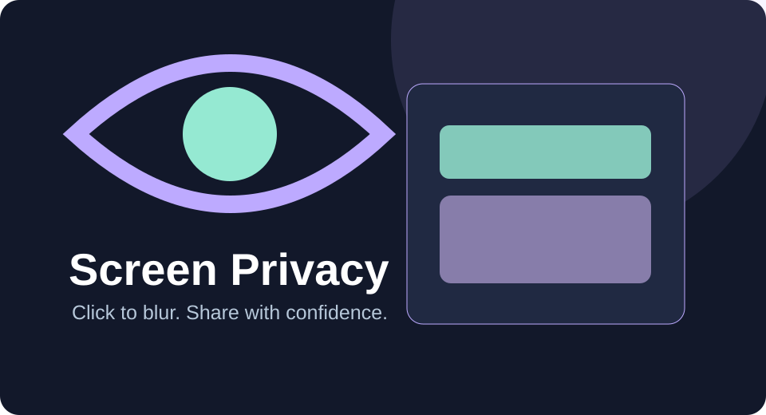

# Screen Privacy

Temporarily blur page components before sharing your screen. This is **visual obscuring**, not secure deletion/redaction.

## Install and use
1. Open `chrome://extensions`, switch on Developer mode and choose Load unpacked.
2. Select the `Tools/screen-privacy` folder containing `manifest.json`.
3. Open a regular web page, open the extension and click **Select elements**.
4. Click any element you wish to obscure. Repeat, then select **Stop selecting**.
5. **Remove all blurs** restores the page, or **Turn off** stops selection and removes blurs. Escape exits selection mode.

## Safety and limitations
- Only the active tab is modified, using temporary CSS blur; refresh the page to remove edits.
- Blurred information may still exist in page markup and accessibility surfaces. **Not a security or DLP tool.** Don't rely on it to conceal secrets from people with access to the page or recording software.
- Browser UI, notifications, other windows, cross-origin frames and protected Chrome pages are not masked.
- No page contents or screenshots are sent to a server; optional Ko-fi configuration loads only in the popup while online.

## Source
[Manifest](./manifest.json) · [Popup](./popup.html) · [Popup controls](./popup.js) · [Page masking](./content.js)
