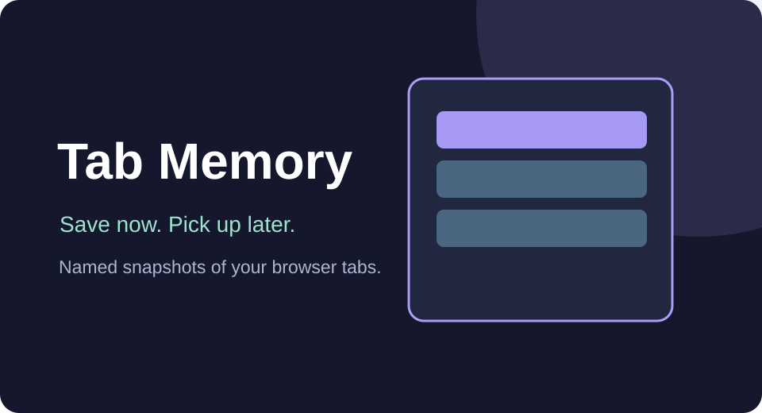

# Tab Memory

Save named snapshots of the current Chrome window's website tabs and restore them later in a new window. Tab Memory is deliberately simple: unlike the existing [TabPocket](../tabpocket/README.md) collection organizer, it focuses on **one-click, named window snapshots**.

## Install and use
1. Open `chrome://extensions`, enable Developer mode, and select Load unpacked.
2. Choose the `Tools/tab-memory` folder with `manifest.json`.
3. Open your websites, click the extension, optionally name the session, and choose **Save current window**.
4. Use **Restore** to open a new Chrome window containing that session's URLs, or **Delete** to remove its saved snapshot.

## Privacy and limitations
Stored locally using Chrome's extension storage: URL, title, session name and save date. No sync and no cloud server. Does not save form contents, page scroll, login states, browsing history or incognito tabs. Chrome-specific internal URLs are intentionally excluded. Up to 100 snapshots are kept. Restoring opens URLs; websites might require you to sign in again. Ko-fi support only loads public remote configuration while online and is hidden offline.

## Source
[Manifest](./manifest.json) · [Popup](./popup.html) · [Popup code](./popup.js)
