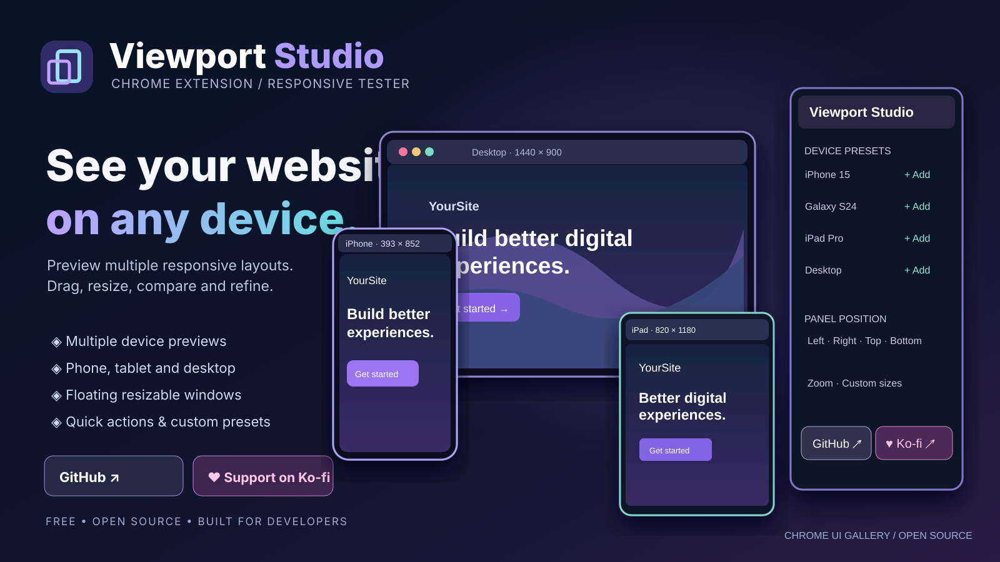

# Viewport Studio

[View full-size showcase poster](./viewport-studio-poster.svg)

**Viewport Studio** is a multi-device responsive design workspace for Chrome. It opens on top of a regular website as an expandable control rail plus independent floating phone, tablet and desktop preview windows.

[← All tools](../README.md) · [← Gallery](../../README.md) · [Extension popup](./popup.html) · [Manifest](./manifest.json)

## Installation

1. Download or clone the [Chrome UI Gallery repository](https://github.com/RuslanSharifov/chrome-ui-gallery).
2. Open `chrome://extensions`, enable **Developer mode** and choose **Load unpacked**.
3. Select **Tools/viewport-studio**, containing [manifest.json](./manifest.json).
4. Open an ordinary HTTP/HTTPS website. Click the Viewport Studio toolbar icon and choose **Open Viewport Studio**.

## Features

- Dock the **collapsible control rail** at the **right**, **left**, **top** or **bottom** of the page; drag its resize handle to make it wider or narrower. Click its compact button to expand or collapse it.
- Drag the lower-right corner of an expanded device to resize its **visual preview**. The simulated CSS viewport dimensions stay unchanged; only the preview scale and displayed frame size adjust.
- GitHub and Ko-fi links are available in the compact control rail as well as the expanded panel. Ko-fi is loaded live from [docs/support-config.json](../../docs/support-config.json) hosted by GitHub Pages, so editing the central account updates it after deployment. Offline or unavailable configuration hides the Ko-fi link.
- Each device opens as an independent floating window. **Left-click and drag a device header** to move it anywhere on the visible page; click a device to bring it forward. Minimize a device to a compact strip and restore it without losing its preset.
- **Right-click anywhere on the inspected page while Viewport Studio is active** to open a cursor-positioned quick menu: add a device, expand the control panel, minimize all devices or deactivate the extension. Right-click actions take precedence over the website’s normal context menu while active; deactivate Studio to restore normal behavior.
- Add multiple presets from phones, tablets and desktop displays, including Apple iPhone and iPad, Samsung Galaxy, Google Pixel, laptop and desktop-size viewport presets.
- Add a **custom width and height** profile.
- Drag individual device windows to arrange them freely. Remove devices, rotate portrait/landscape, reload a device, or change its preset independently.
- Tune **zoom**, device labels, visual shadows, and optional same-origin scroll syncing. Settings, control-panel width, window positions and device list persist in `chrome.storage.local`.
- Copy a selected viewport's CSS/media-query dimensions by reading the displayed width and height.
- An online-only, centrally configured Ko-fi card appears in the extension popup and in the workspace, plus a direct GitHub source link.

## Embedding limitations (important)

Viewport Studio uses isolated **iframe previews** of the current page. Websites with **X-Frame-Options** or CSP `frame-ancestors` restrictions **cannot be embedded**. Chrome extension permissions do not override those protections. Authentication, session, `SameSite` cookies, service workers, and frame restrictions can make embedded content differ from a normal top-level tab. Some pages may refuse rendering or interactive features.

A preset changes the iframe CSS viewport size; it **does not faithfully emulate** its brand's hardware, operating system, Safari rendering engine, device pixel ratio, or mobile touch behavior. For precise or blocked-site testing, use **Chrome DevTools → Toggle device toolbar (Ctrl+Shift+M)** or open the page in a real device. Do not attempt to bypass a site's framing protections.

All preview requests are to the website you are inspecting. No page content is uploaded to the gallery. Ko-fi config is retrieved only when its support UI is visible and online.
