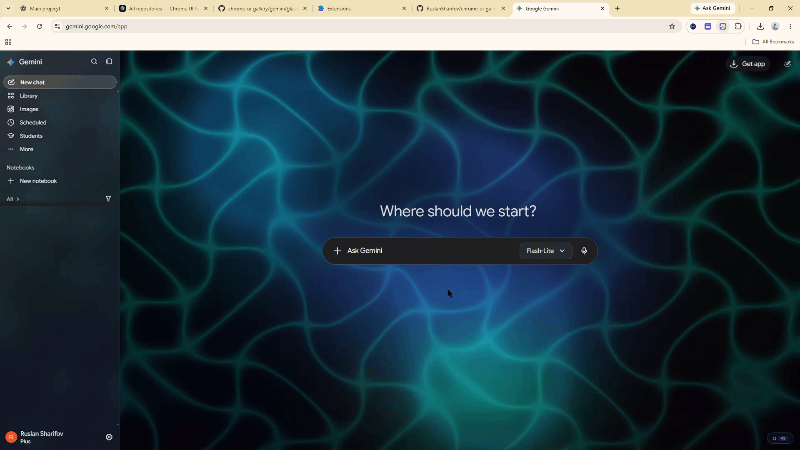

# Gemini Glassmorphism

A glassmorphism UI redesign for the Google Gemini web app, delivered as a Chrome Manifest V3 extension. It applies frosted panels, adaptive light/dark styling and optional atmospheric lighting without replacing Gemini's chat functionality.

## Animated preview

[View full-size GIF](./gemini-glassmorphism-preview.gif) · [Live gallery](https://ruslansharifov.github.io/chrome-ui-gallery/gallery.html?category=ui&q=Gemini%20Glassmorphism) · [Full design documentation](./design.md)

## Highlights

- Glassmorphism styling for the sidebar, conversation, composer, menus and dialogs.
- Five presets: Underwater, Cyberpunk, Aurora, Calm and Minimal.
- Adjustable blur, opacity, accent, lighting, glow and roundness.
- Optional WebGL atmospheric effects, with performance and reduced-motion considerations.
- Supports Gemini light and dark themes.

## Install in Chrome

1. Download the repository or the extension ZIP from the [live gallery](https://ruslansharifov.github.io/chrome-ui-gallery/gallery.html?category=ui&q=Gemini%20Glassmorphism).
2. Open `chrome://extensions` and enable **Developer mode**.
3. Click **Load unpacked** and select this `gemini-glassmorphism` folder (the one containing `manifest.json`).
4. Open or refresh [Gemini](https://gemini.google.com/) and use the extension popup to enable and customize the UI.

## Project files

- [design.md](./design.md) — complete design specification, usage and troubleshooting.
- [manifest.json](./manifest.json) — Chrome extension configuration.
- [index.html](./index.html), [style.css](./style.css), [script.js](./script.js) — settings popup.
- [glass.css](./glass.css) — Gemini visual overrides.
- [content.js](./content.js), [shared.js](./shared.js), [fx.js](./fx.js) — integration, preferences and optional lighting.
- [gallery.json](./gallery.json) — gallery listing metadata.
- [CHANGELOG.md](./CHANGELOG.md) — release notes.
- [Animated GIF](./gemini-glassmorphism-preview.gif) — demonstration of the UI.

## Navigation

[← Gemini designs](../../README.md) · [← Chrome UI Gallery](../../../README.md) · [Browse all designs](https://ruslansharifov.github.io/chrome-ui-gallery/gallery.html)
